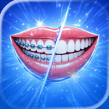
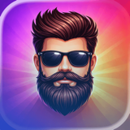

# Hi, I'm Tunahan 👋

**Independent iOS developer in Istanbul.** I make iPhone apps made with care, used around the world.

[Website](https://tunahanaktay.com) · [App Store](https://apps.apple.com/developer/id1718150465) · [LinkedIn](https://www.linkedin.com/in/tunahan-aktay) · [X](https://x.com/tunimba) · [Email](mailto:tunahanaktay.apps@gmail.com)

 

| **16** apps shipped | **50,000+** downloads | **$28,000+** earned on the App Store | First release **2024** |
|:---:|:---:|:---:|:---:|

## About

I studied psychology, and my first app came straight out of that: psychology and mental health, explained and practiced a little every day.

Since then I've built apps for the small moments people care about. Seeing a new haircut before the salon, saving a faded family photo, finding the right phone number in Türkiye, picturing your smile without braces. Each one is focused, fast and translated so people can use it in their own language.

## Apps

<table>
  <tr>
    <td align="center" width="112"><a href="https://vizeaapp.com"> <b>Vizea</b></a></td>
    <td align="center" width="112"><a href="https://signafyapp.com"> <b>Signafy</b></a></td>
    <td align="center" width="112"><a href="https://bibiq.app"> <b>BibiQ</b></a></td>
    <td align="center" width="112"><a href="https://fanfy.app"> <b>Fanfy</b></a></td>
    <td align="center" width="112"><a href="https://babyoo.app"> <b>Babyoo</b></a></td>
    <td align="center" width="112"><a href="https://bracesoff.app"> <b>BracesOff</b></a></td>
  </tr>
  <tr>
    <td align="center" width="112"><a href="https://beardio.app"> <b>Beardio</b></a></td>
    <td align="center" width="112"><a href="https://muslimwell.app"> <b>MuslimWell</b></a></td>
    <td align="center" width="112"><a href="https://glarefy.app"> <b>Glarefy</b></a></td>
    <td align="center" width="112"><a href="https://hairvy.app"> <b>Hairvy</b></a></td>
    <td align="center" width="112"><a href="https://phixphoto.com"> <b>Phix</b></a></td>
    <td align="center" width="112"><a href="https://aixy.app"> <b>Aixy</b></a></td>
  </tr>
  <tr>
    <td align="center" width="112"><a href="https://apps.apple.com/app/id6742585033"> <b>Foodr</b></a></td>
    <td align="center" width="112"><a href="https://qr8app.com"> <b>QR8</b></a></td>
    <td align="center" width="112"><a href="https://alotr.app"> <b>AloTR</b></a></td>
    <td align="center" width="112"><a href="https://psychly.app"> <b>Psychly</b></a></td>
  </tr>
</table>

<b>What each app does</b> (newest first)

 

| App | What it does | |
|---|---|---|
| [Vizea](https://vizeaapp.com) | A vision board you will actually look at every day. | [App Store](https://apps.apple.com/app/id6805220299) |
| [Signafy](https://signafyapp.com) | Turn your name into a signature worth signing. | [App Store](https://apps.apple.com/app/id6791304781) |
| [BibiQ](https://bibiq.app) | Illustrated Bible stories that help kids learn and grow. | [App Store](https://apps.apple.com/app/id6745804307) |
| [Fanfy](https://fanfy.app) | Wear your national team's colors in one selfie. | [App Store](https://apps.apple.com/app/id6779004535) |
| [Babyoo](https://babyoo.app) | See what your future baby could look like. | [App Store](https://apps.apple.com/app/id6759849805) |
| [BracesOff](https://bracesoff.app) | See your smile without braces, today. | [App Store](https://apps.apple.com/app/id6759583426) |
| [Beardio](https://beardio.app) | Try any beard or mustache before you grow it. | [App Store](https://apps.apple.com/app/id6758737900) |
| [MuslimWell](https://muslimwell.app) | Track fasting, calories and nutrition through Ramadan. | [App Store](https://apps.apple.com/app/id6758867116) |
| [Glarefy](https://glarefy.app) | Erase the glare from your glasses in photos. | [App Store](https://apps.apple.com/app/id6752567334) |
| [Hairvy](https://hairvy.app) | Try a haircut or a hair color before the salon. | [App Store](https://apps.apple.com/app/id6747626699) |
| [Phix](https://phixphoto.com) | Restore, unblur and colorize old family photos. | [App Store](https://apps.apple.com/app/id6746735198) |
| [Aixy](https://aixy.app) | Turn any photo into art, cartoons and new scenes. | [App Store](https://apps.apple.com/app/id6743885144) |
| [Foodr](https://apps.apple.com/app/id6742585033) | Snap a meal, get its calories and ingredients. | [App Store](https://apps.apple.com/app/id6742585033) |
| [QR8](https://qr8app.com) | Scan, create and style every kind of code. | [App Store](https://apps.apple.com/app/id6737692733) |
| [AloTR](https://alotr.app) | Every official and customer line in Türkiye, one tap away. | [App Store](https://apps.apple.com/app/id6505045783) |
| [Psychly](https://psychly.app) | Psychology and mental health, explained and practiced daily. | [App Store](https://apps.apple.com/app/id6472971185) |

**Next:** 2 new apps on the way. The names stay hidden until launch day.

## Tools I work with

SwiftUI · Swift · Xcode Cloud · RevenueCat · App Store Connect API · Apple Search Ads · Cloudflare Workers · Astro · Firebase · Figma

 
More on <a href="https://tunahanaktay.com">tunahanaktay.com</a> · <a href="https://tunahanaktay.com/press">Press kit</a>

