
<a href="https://github.com/tunimba/tunimba/blob/main/README.md"><picture><source media="(prefers-color-scheme: dark)" srcset="images/lang-en-on-dark.webp"/></picture></a> <a href="https://github.com/tunimba/tunimba/blob/main/README.tr.md"><picture><source media="(prefers-color-scheme: dark)" srcset="images/lang-tr-off-dark.webp"/></picture></a>

<a href="https://tunahanaktay.com"><picture><source media="(prefers-color-scheme: dark)" srcset="images/hero-dark.webp"/>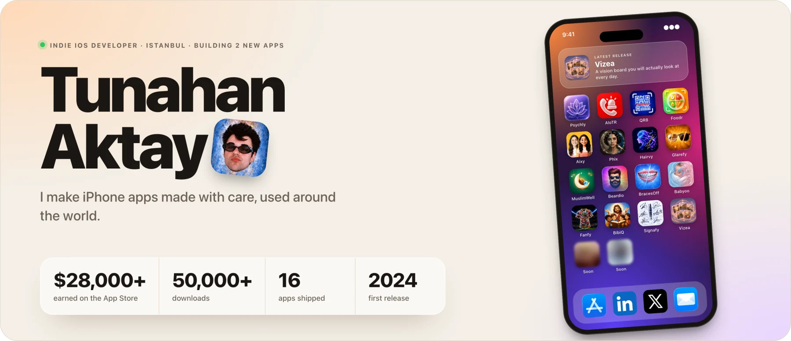</picture></a>

## The shelf

Everything I've shipped, newest first. Every one is free to download on iPhone.

<table>
<tr><td width="25%" align="center"><a href="https://vizeaapp.com"><picture><source media="(prefers-color-scheme: dark)" srcset="images/apps/vizea-dark.webp"/>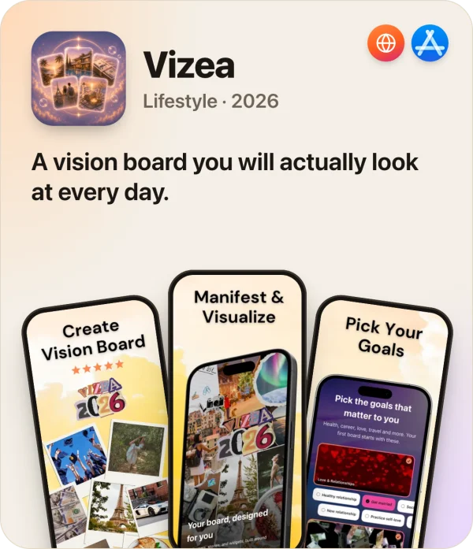</picture></a> <a href="https://vizeaapp.com"><picture><source media="(prefers-color-scheme: dark)" srcset="images/pill-website-dark.webp"/>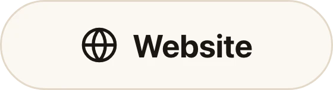</picture></a> <a href="https://apps.apple.com/app/id6805220299"><picture><source media="(prefers-color-scheme: dark)" srcset="images/pill-appstore-dark.webp"/></picture></a></td><td width="25%" align="center"><a href="https://signafyapp.com"><picture><source media="(prefers-color-scheme: dark)" srcset="images/apps/signafy-dark.webp"/>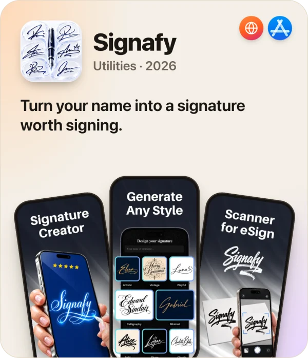</picture></a> <a href="https://signafyapp.com"><picture><source media="(prefers-color-scheme: dark)" srcset="images/pill-website-dark.webp"/></picture></a> <a href="https://apps.apple.com/app/id6791304781"><picture><source media="(prefers-color-scheme: dark)" srcset="images/pill-appstore-dark.webp"/></picture></a></td><td width="25%" align="center"><a href="https://bibiq.app"><picture><source media="(prefers-color-scheme: dark)" srcset="images/apps/bibiq-dark.webp"/>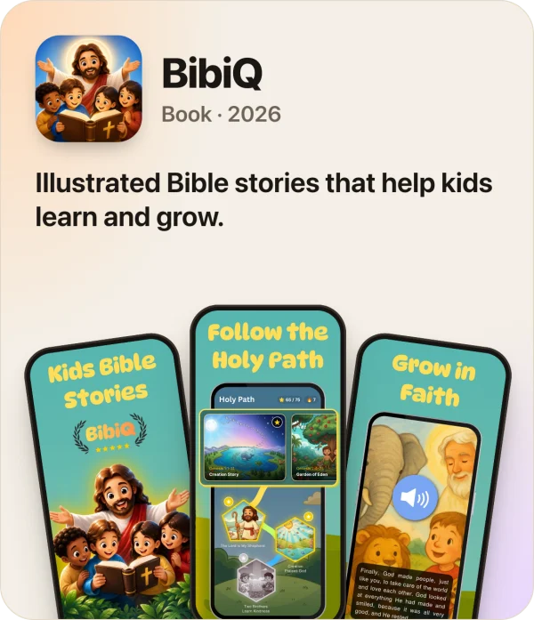</picture></a> <a href="https://bibiq.app"><picture><source media="(prefers-color-scheme: dark)" srcset="images/pill-website-dark.webp"/></picture></a> <a href="https://apps.apple.com/app/id6745804307"><picture><source media="(prefers-color-scheme: dark)" srcset="images/pill-appstore-dark.webp"/></picture></a></td><td width="25%" align="center"><a href="https://fanfy.app"><picture><source media="(prefers-color-scheme: dark)" srcset="images/apps/fanfy-dark.webp"/>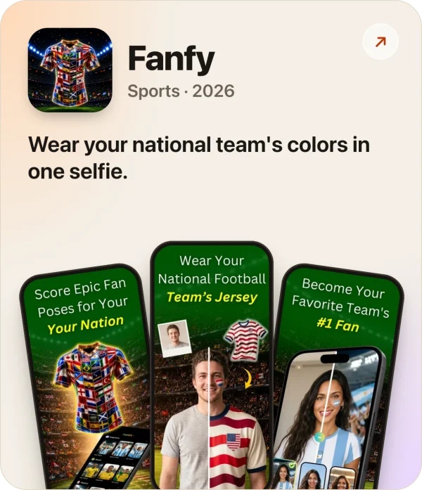</picture></a> <a href="https://fanfy.app"><picture><source media="(prefers-color-scheme: dark)" srcset="images/pill-website-dark.webp"/></picture></a> <a href="https://apps.apple.com/app/id6779004535"><picture><source media="(prefers-color-scheme: dark)" srcset="images/pill-appstore-dark.webp"/></picture></a></td></tr>
<tr><td width="25%" align="center"><a href="https://babyoo.app"><picture><source media="(prefers-color-scheme: dark)" srcset="images/apps/babyoo-dark.webp"/>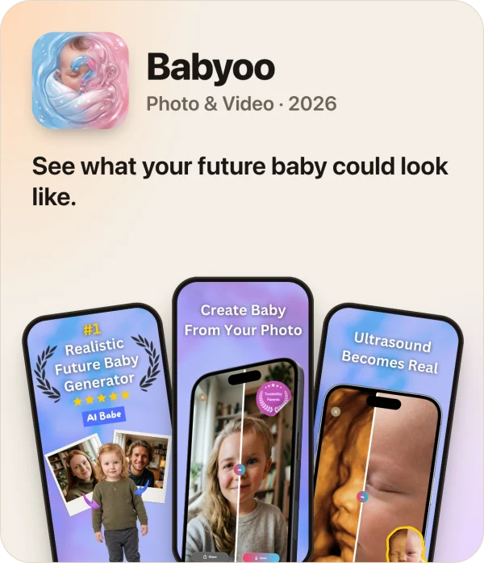</picture></a> <a href="https://babyoo.app"><picture><source media="(prefers-color-scheme: dark)" srcset="images/pill-website-dark.webp"/></picture></a> <a href="https://apps.apple.com/app/id6759849805"><picture><source media="(prefers-color-scheme: dark)" srcset="images/pill-appstore-dark.webp"/></picture></a></td><td width="25%" align="center"><a href="https://bracesoff.app"><picture><source media="(prefers-color-scheme: dark)" srcset="images/apps/bracesoff-dark.webp"/>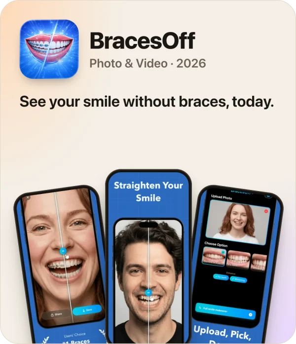</picture></a> <a href="https://bracesoff.app"><picture><source media="(prefers-color-scheme: dark)" srcset="images/pill-website-dark.webp"/></picture></a> <a href="https://apps.apple.com/app/id6759583426"><picture><source media="(prefers-color-scheme: dark)" srcset="images/pill-appstore-dark.webp"/></picture></a></td><td width="25%" align="center"><a href="https://beardio.app"><picture><source media="(prefers-color-scheme: dark)" srcset="images/apps/beardio-dark.webp"/>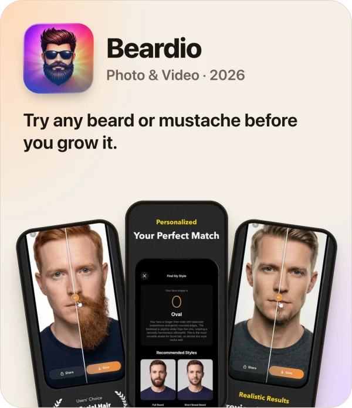</picture></a> <a href="https://beardio.app"><picture><source media="(prefers-color-scheme: dark)" srcset="images/pill-website-dark.webp"/></picture></a> <a href="https://apps.apple.com/app/id6758737900"><picture><source media="(prefers-color-scheme: dark)" srcset="images/pill-appstore-dark.webp"/></picture></a></td><td width="25%" align="center"><a href="https://muslimwell.app"><picture><source media="(prefers-color-scheme: dark)" srcset="images/apps/muslimwell-dark.webp"/>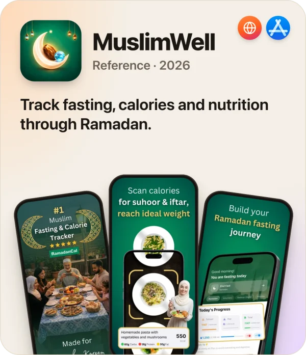</picture></a> <a href="https://muslimwell.app"><picture><source media="(prefers-color-scheme: dark)" srcset="images/pill-website-dark.webp"/></picture></a> <a href="https://apps.apple.com/app/id6758867116"><picture><source media="(prefers-color-scheme: dark)" srcset="images/pill-appstore-dark.webp"/></picture></a></td></tr>
<tr><td width="25%" align="center"><a href="https://glarefy.app"><picture><source media="(prefers-color-scheme: dark)" srcset="images/apps/glarefy-dark.webp"/>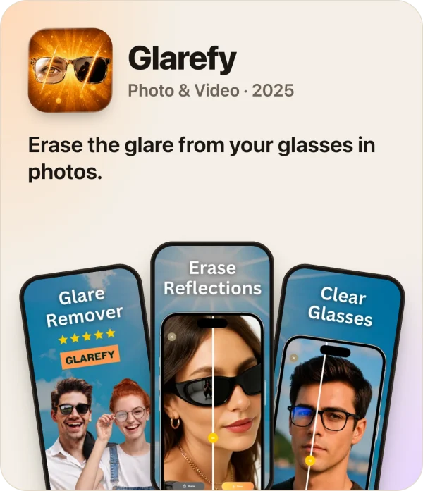</picture></a> <a href="https://glarefy.app"><picture><source media="(prefers-color-scheme: dark)" srcset="images/pill-website-dark.webp"/></picture></a> <a href="https://apps.apple.com/app/id6752567334"><picture><source media="(prefers-color-scheme: dark)" srcset="images/pill-appstore-dark.webp"/></picture></a></td><td width="25%" align="center"><a href="https://hairvy.app"><picture><source media="(prefers-color-scheme: dark)" srcset="images/apps/hairvy-dark.webp"/>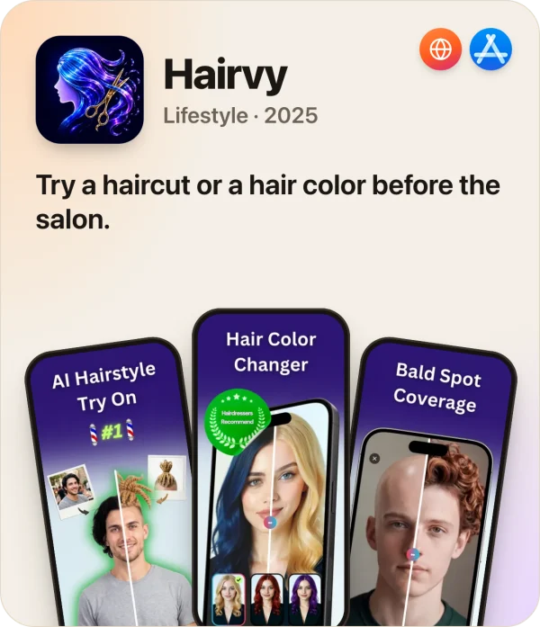</picture></a> <a href="https://hairvy.app"><picture><source media="(prefers-color-scheme: dark)" srcset="images/pill-website-dark.webp"/></picture></a> <a href="https://apps.apple.com/app/id6747626699"><picture><source media="(prefers-color-scheme: dark)" srcset="images/pill-appstore-dark.webp"/></picture></a></td><td width="25%" align="center"><a href="https://phixphoto.com"><picture><source media="(prefers-color-scheme: dark)" srcset="images/apps/phix-dark.webp"/>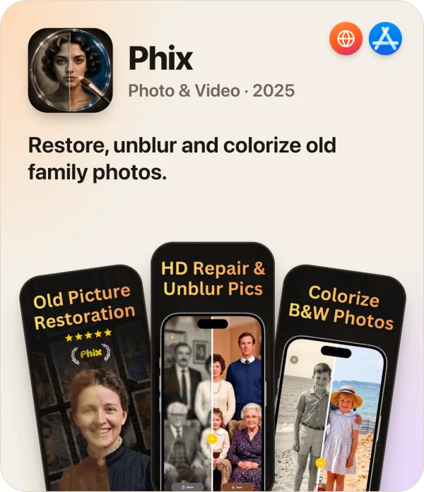</picture></a> <a href="https://phixphoto.com"><picture><source media="(prefers-color-scheme: dark)" srcset="images/pill-website-dark.webp"/></picture></a> <a href="https://apps.apple.com/app/id6746735198"><picture><source media="(prefers-color-scheme: dark)" srcset="images/pill-appstore-dark.webp"/></picture></a></td><td width="25%" align="center"><a href="https://aixy.app"><picture><source media="(prefers-color-scheme: dark)" srcset="images/apps/aixy-dark.webp"/>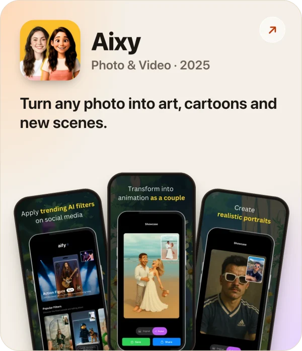</picture></a> <a href="https://aixy.app"><picture><source media="(prefers-color-scheme: dark)" srcset="images/pill-website-dark.webp"/></picture></a> <a href="https://apps.apple.com/app/id6743885144"><picture><source media="(prefers-color-scheme: dark)" srcset="images/pill-appstore-dark.webp"/></picture></a></td></tr>
<tr><td width="25%" align="center"><a href="https://apps.apple.com/app/id6742585033"><picture><source media="(prefers-color-scheme: dark)" srcset="images/apps/foodr-dark.webp"/>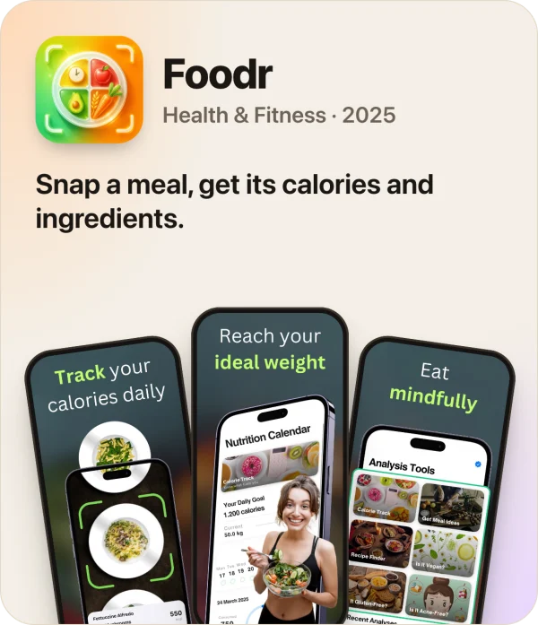</picture></a> <a href="https://apps.apple.com/app/id6742585033"><picture><source media="(prefers-color-scheme: dark)" srcset="images/pill-appstore-dark.webp"/></picture></a></td><td width="25%" align="center"><a href="https://qr8app.com"><picture><source media="(prefers-color-scheme: dark)" srcset="images/apps/qr8-dark.webp"/></picture></a> <a href="https://qr8app.com"><picture><source media="(prefers-color-scheme: dark)" srcset="images/pill-website-dark.webp"/></picture></a> <a href="https://apps.apple.com/app/id6737692733"><picture><source media="(prefers-color-scheme: dark)" srcset="images/pill-appstore-dark.webp"/></picture></a></td><td width="25%" align="center"><a href="https://alotr.app"><picture><source media="(prefers-color-scheme: dark)" srcset="images/apps/alotr-dark.webp"/>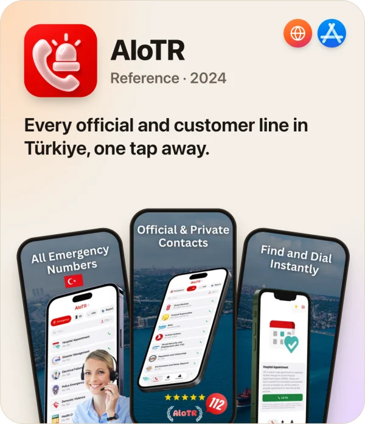</picture></a> <a href="https://alotr.app"><picture><source media="(prefers-color-scheme: dark)" srcset="images/pill-website-dark.webp"/></picture></a> <a href="https://apps.apple.com/app/id6505045783"><picture><source media="(prefers-color-scheme: dark)" srcset="images/pill-appstore-dark.webp"/></picture></a></td><td width="25%" align="center"><a href="https://psychly.app"><picture><source media="(prefers-color-scheme: dark)" srcset="images/apps/psychly-dark.webp"/>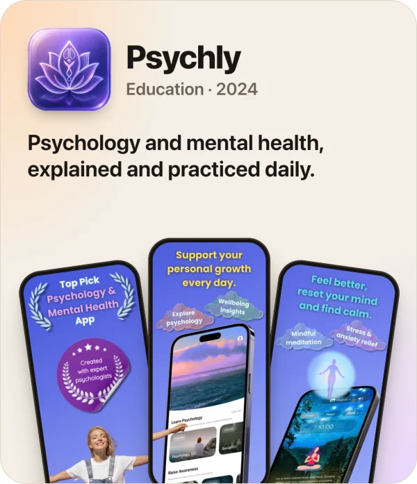</picture></a> <a href="https://psychly.app"><picture><source media="(prefers-color-scheme: dark)" srcset="images/pill-website-dark.webp"/></picture></a> <a href="https://apps.apple.com/app/id6472971185"><picture><source media="(prefers-color-scheme: dark)" srcset="images/pill-appstore-dark.webp"/></picture></a></td></tr>
</table>

<picture><source media="(prefers-color-scheme: dark)" srcset="images/next-dark.webp"/>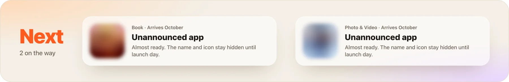</picture>

## About

I'm Tunahan, an independent iOS developer in Istanbul. I studied psychology, and my first app came straight out of that: psychology and mental health, explained and practiced a little every day.

Since then I've built apps for the small moments people care about. Seeing a new haircut before the salon, saving a faded family photo, finding the right phone number in Türkiye, picturing your smile without braces. Each one is focused, fast and translated so people can use it in their own language.

SwiftUI · Swift · Xcode Cloud · RevenueCat · App Store Connect API · Apple Search Ads · Cloudflare Workers · Astro · Firebase · Figma

 

<a href="https://tunahanaktay.com"><picture><source media="(prefers-color-scheme: dark)" srcset="images/dock/website-dark.webp"/></picture></a> <a href="https://apps.apple.com/developer/id1718150465"><picture><source media="(prefers-color-scheme: dark)" srcset="images/dock/app-store-dark.webp"/></picture></a> <a href="https://www.linkedin.com/in/tunahan-aktay"><picture><source media="(prefers-color-scheme: dark)" srcset="images/dock/linkedin-dark.webp"/></picture></a> <a href="https://x.com/tunimba"><picture><source media="(prefers-color-scheme: dark)" srcset="images/dock/x-dark.webp"/></picture></a> <a href="mailto:tunahanaktay.apps@gmail.com"><picture><source media="(prefers-color-scheme: dark)" srcset="images/dock/mail-dark.webp"/></picture></a>

<a href="https://tunahanaktay.com"><picture><source media="(prefers-color-scheme: dark)" srcset="images/link-site-dark.webp"/></picture></a> <a href="https://tunahanaktay.com/press"><picture><source media="(prefers-color-scheme: dark)" srcset="images/link-press-dark.webp"/>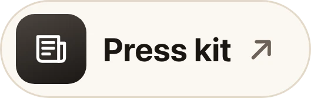</picture></a>

