
<a href="https://github.com/tunimba/tunimba/blob/main/README.md"><picture><source media="(prefers-color-scheme: dark)" srcset="images/lang-en-off-dark.webp"/>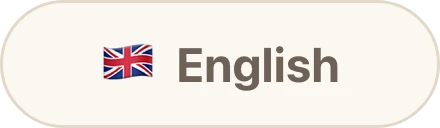</picture></a> <a href="https://github.com/tunimba/tunimba/blob/main/README.tr.md"><picture><source media="(prefers-color-scheme: dark)" srcset="images/lang-tr-on-dark.webp"/>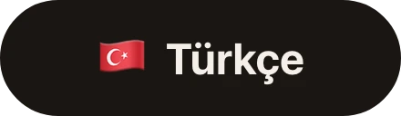</picture></a>

<a href="https://tunahanaktay.com/tr/"><picture><source media="(prefers-color-scheme: dark)" srcset="images/hero-tr-dark.webp"/>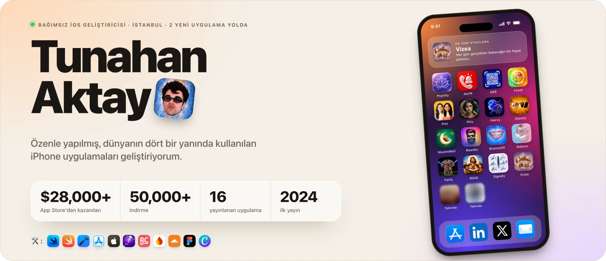</picture></a>

## Hakkımda

Ben Tunahan, İstanbul'da bağımsız bir iOS geliştiricisiyim. Psikoloji okudum ve ilk uygulamam tam olarak oradan çıktı: psikolojiyi ve ruh sağlığını her gün biraz anlatan, biraz da pratiğe döken bir uygulama.

O günden beri insanların önemsediği küçük anlar için uygulamalar yapıyorum. Kuaföre gitmeden yeni saçını görmek, solmuş bir aile fotoğrafını kurtarmak, Türkiye'de doğru telefon numarasını bulmak, tellerden kurtulmuş gülüşünü önceden hayal etmek. Her biri tek bir işe odaklı, hızlı ve herkes kendi dilinde kullanabilsin diye çevrilmiş.

<picture><source media="(prefers-color-scheme: dark)" srcset="images/tools-tr-dark.webp"/></picture>

## Bugüne kadar yayınladıklarım

En yeniler başta. Hepsi iPhone'da ücretsiz indirilebilir. App Store'da açmak için bir karta dokun.

<table>
<tr><td width="25%"><a href="https://apps.apple.com/app/id6805220299"><picture><source media="(prefers-color-scheme: dark)" srcset="images/apps/vizea-tr-dark.webp"/>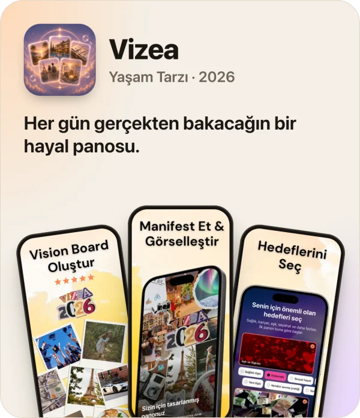</picture></a></td><td width="25%"><a href="https://apps.apple.com/app/id6791304781"><picture><source media="(prefers-color-scheme: dark)" srcset="images/apps/signafy-tr-dark.webp"/>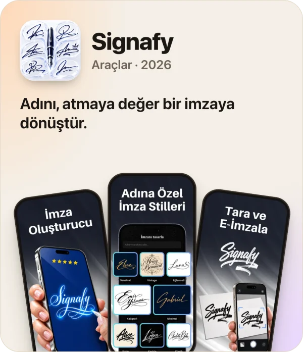</picture></a></td><td width="25%"><a href="https://apps.apple.com/app/id6745804307"><picture><source media="(prefers-color-scheme: dark)" srcset="images/apps/bibiq-tr-dark.webp"/>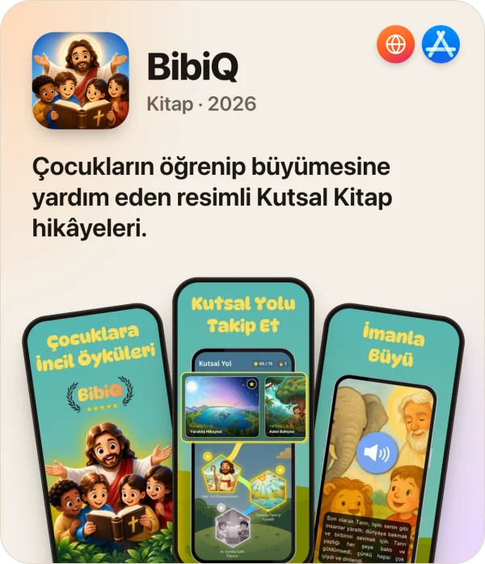</picture></a></td><td width="25%"><a href="https://apps.apple.com/app/id6779004535"><picture><source media="(prefers-color-scheme: dark)" srcset="images/apps/fanfy-tr-dark.webp"/>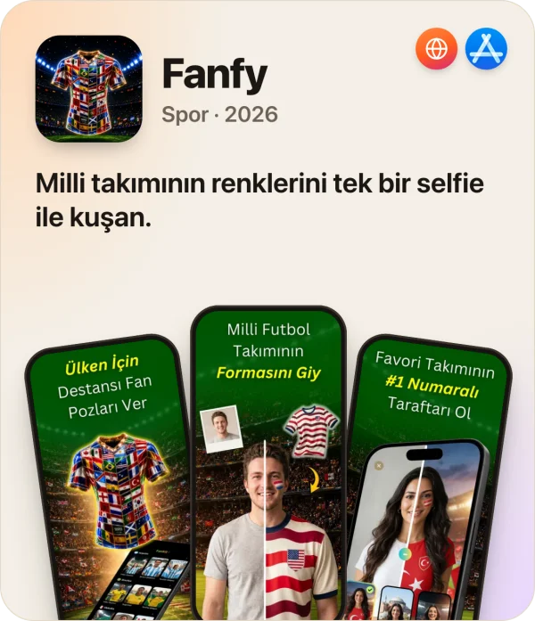</picture></a></td></tr>
<tr><td width="25%"><a href="https://apps.apple.com/app/id6759849805"><picture><source media="(prefers-color-scheme: dark)" srcset="images/apps/babyoo-tr-dark.webp"/>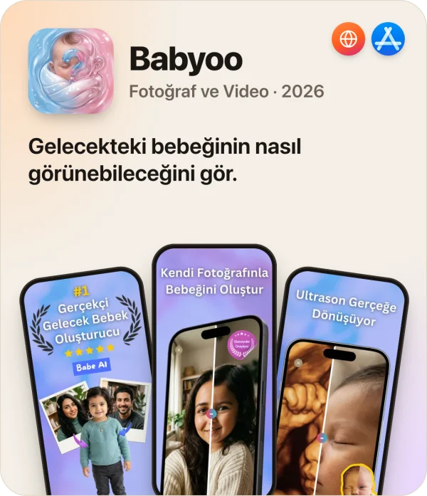</picture></a></td><td width="25%"><a href="https://apps.apple.com/app/id6759583426"><picture><source media="(prefers-color-scheme: dark)" srcset="images/apps/bracesoff-tr-dark.webp"/>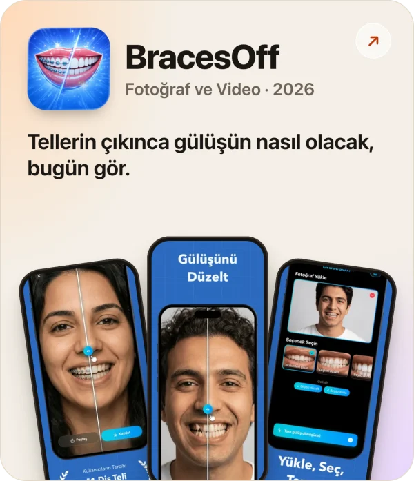</picture></a></td><td width="25%"><a href="https://apps.apple.com/app/id6758737900"><picture><source media="(prefers-color-scheme: dark)" srcset="images/apps/beardio-tr-dark.webp"/>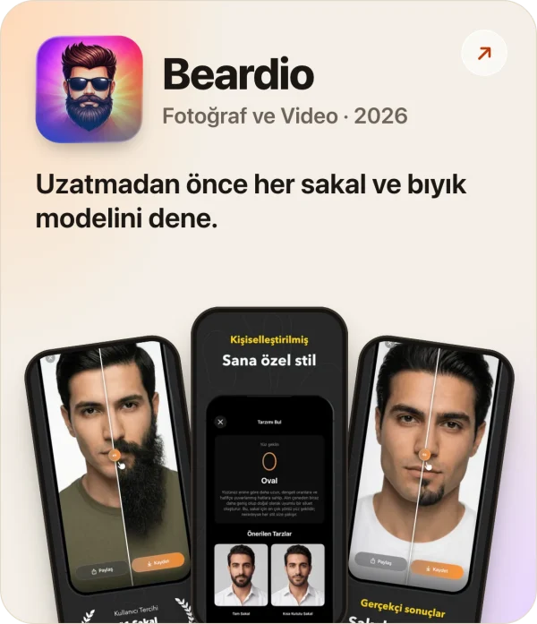</picture></a></td><td width="25%"><a href="https://apps.apple.com/app/id6758867116"><picture><source media="(prefers-color-scheme: dark)" srcset="images/apps/muslimwell-tr-dark.webp"/>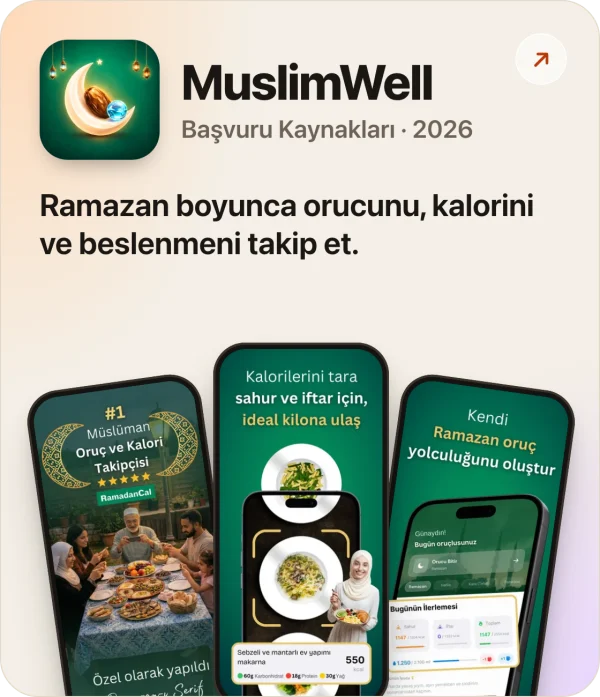</picture></a></td></tr>
<tr><td width="25%"><a href="https://apps.apple.com/app/id6752567334"><picture><source media="(prefers-color-scheme: dark)" srcset="images/apps/glarefy-tr-dark.webp"/>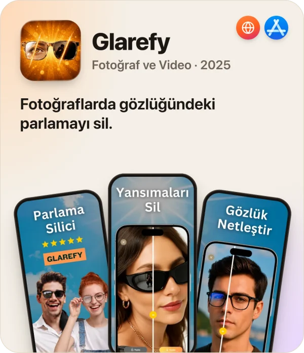</picture></a></td><td width="25%"><a href="https://apps.apple.com/app/id6747626699"><picture><source media="(prefers-color-scheme: dark)" srcset="images/apps/hairvy-tr-dark.webp"/>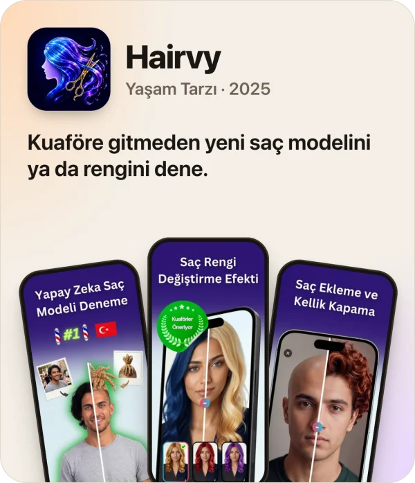</picture></a></td><td width="25%"><a href="https://apps.apple.com/app/id6746735198"><picture><source media="(prefers-color-scheme: dark)" srcset="images/apps/phix-tr-dark.webp"/>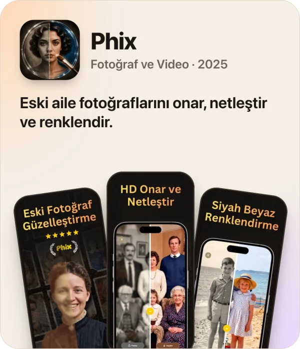</picture></a></td><td width="25%"><a href="https://apps.apple.com/app/id6743885144"><picture><source media="(prefers-color-scheme: dark)" srcset="images/apps/aixy-tr-dark.webp"/>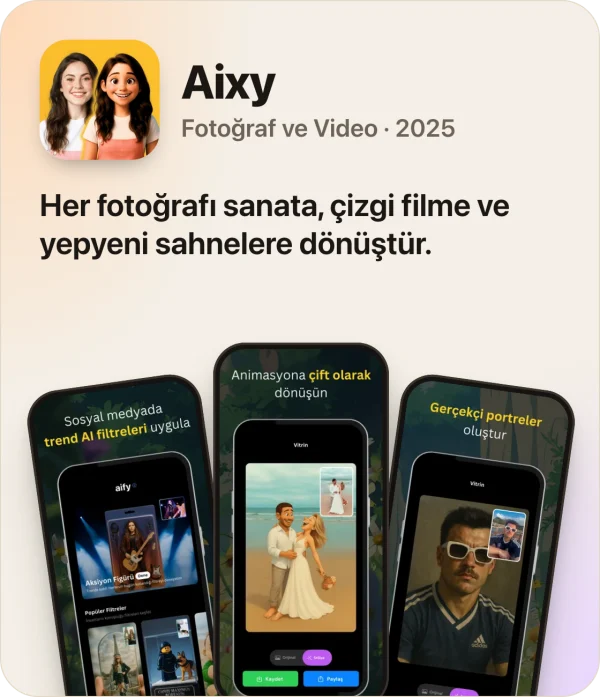</picture></a></td></tr>
<tr><td width="25%"><a href="https://apps.apple.com/app/id6742585033"><picture><source media="(prefers-color-scheme: dark)" srcset="images/apps/foodr-tr-dark.webp"/>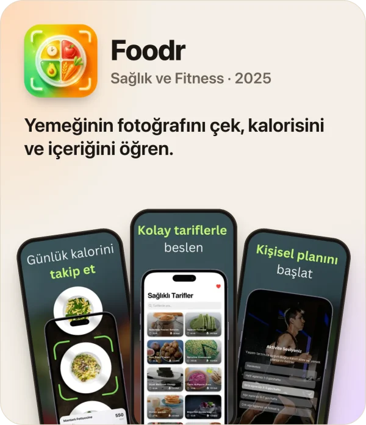</picture></a></td><td width="25%"><a href="https://apps.apple.com/app/id6737692733"><picture><source media="(prefers-color-scheme: dark)" srcset="images/apps/qr8-tr-dark.webp"/>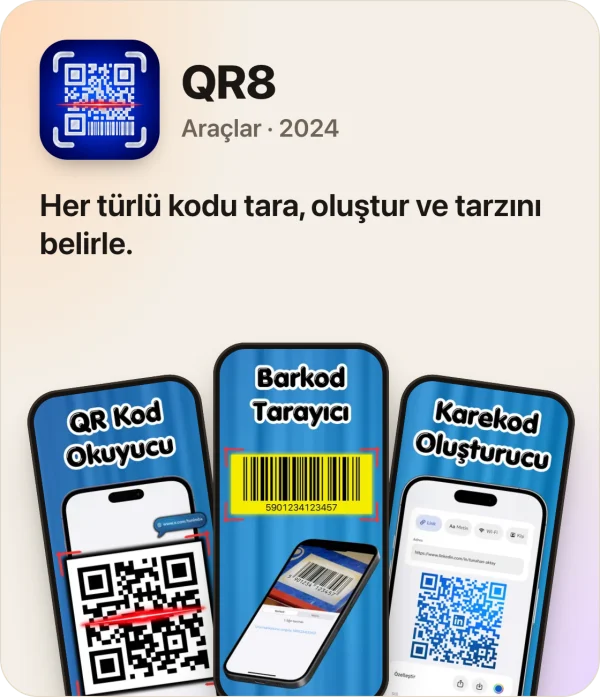</picture></a></td><td width="25%"><a href="https://apps.apple.com/app/id6505045783"><picture><source media="(prefers-color-scheme: dark)" srcset="images/apps/alotr-tr-dark.webp"/>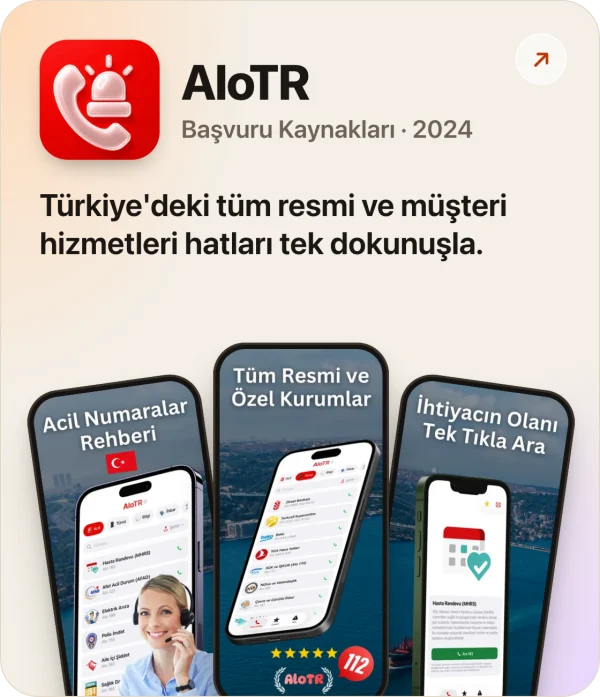</picture></a></td><td width="25%"><a href="https://apps.apple.com/app/id6472971185"><picture><source media="(prefers-color-scheme: dark)" srcset="images/apps/psychly-tr-dark.webp"/>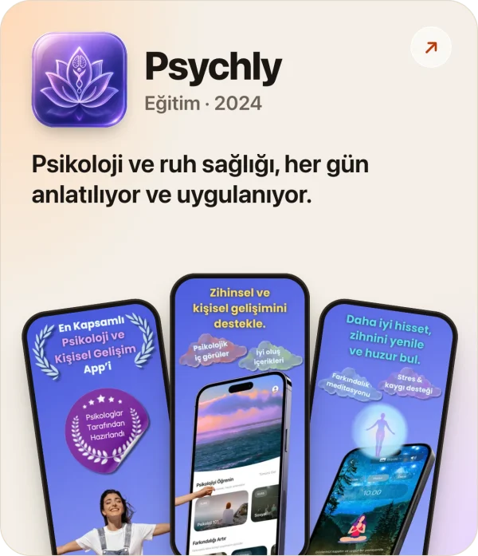</picture></a></td></tr>
</table>

<picture><source media="(prefers-color-scheme: dark)" srcset="images/next-tr-dark.webp"/>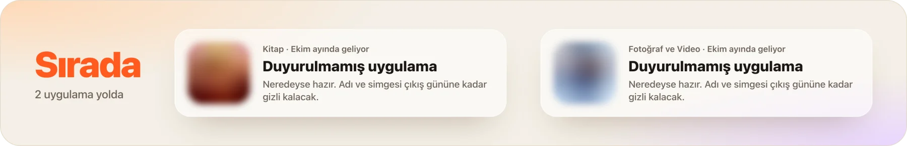</picture>

 

<a href="https://tunahanaktay.com/tr/"><picture><source media="(prefers-color-scheme: dark)" srcset="images/dock/website-dark.webp"/></picture></a> <a href="https://apps.apple.com/developer/id1718150465"><picture><source media="(prefers-color-scheme: dark)" srcset="images/dock/app-store-dark.webp"/>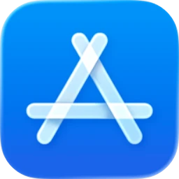</picture></a> <a href="https://www.linkedin.com/in/tunahan-aktay"><picture><source media="(prefers-color-scheme: dark)" srcset="images/dock/linkedin-dark.webp"/></picture></a> <a href="https://x.com/tunimba"><picture><source media="(prefers-color-scheme: dark)" srcset="images/dock/x-dark.webp"/></picture></a> <a href="mailto:tunahanaktay.apps@gmail.com"><picture><source media="(prefers-color-scheme: dark)" srcset="images/dock/mail-dark.webp"/></picture></a>

<a href="https://tunahanaktay.com/tr/"><picture><source media="(prefers-color-scheme: dark)" srcset="images/link-site-dark.webp"/>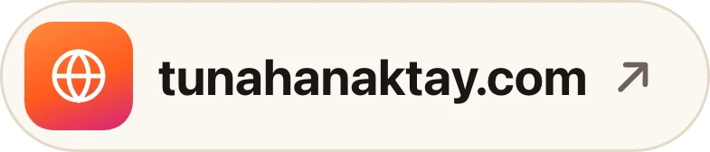</picture></a> <a href="https://tunahanaktay.com/tr/press/"><picture><source media="(prefers-color-scheme: dark)" srcset="images/link-press-tr-dark.webp"/>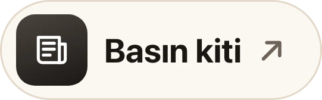</picture></a>

